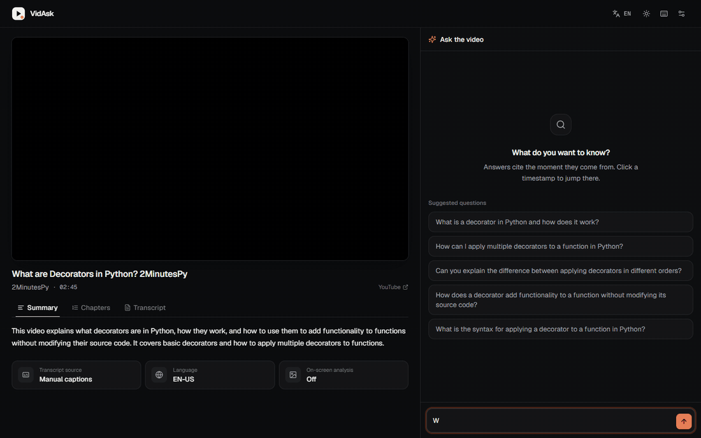
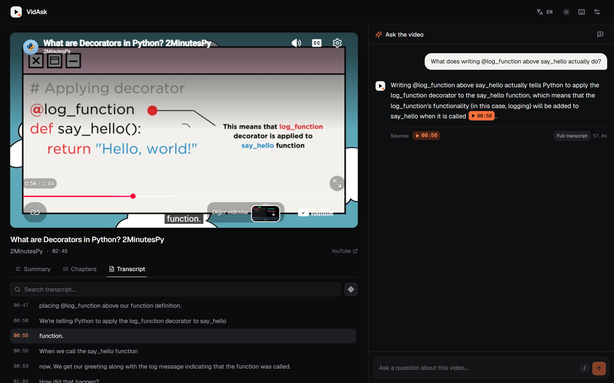
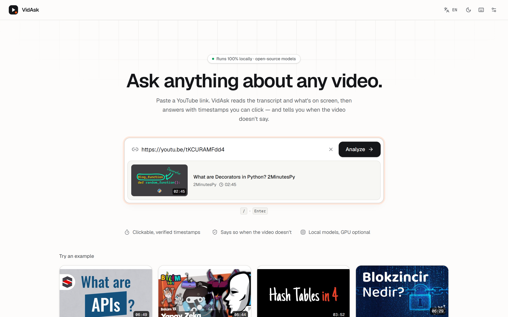
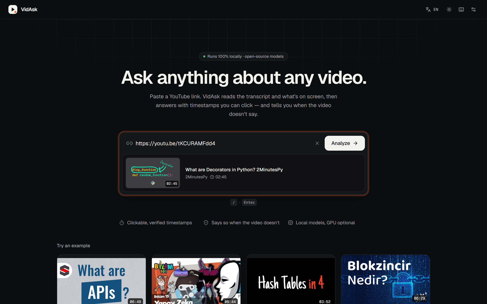
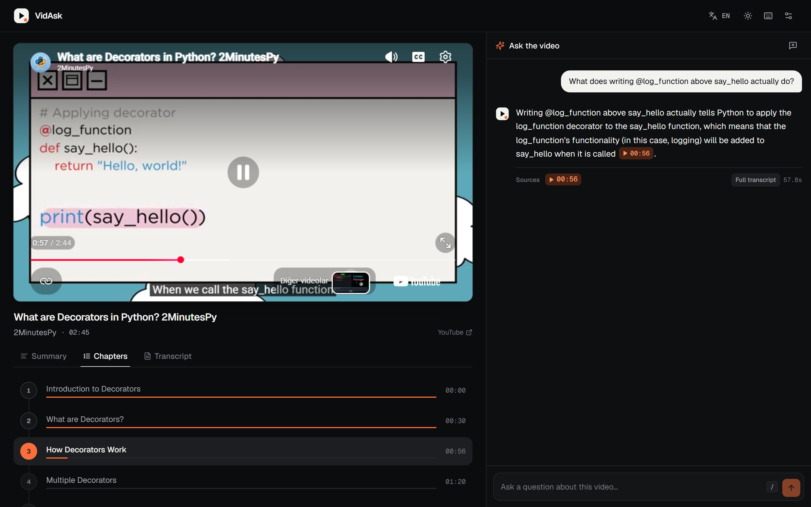
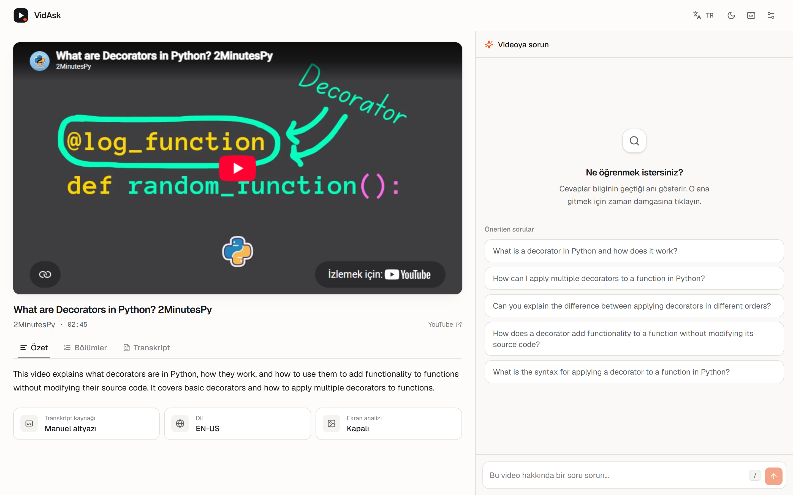
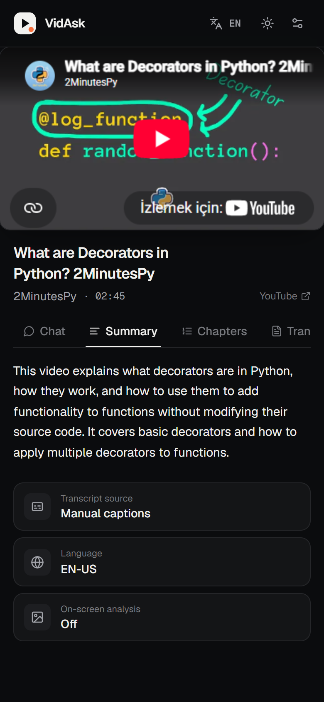
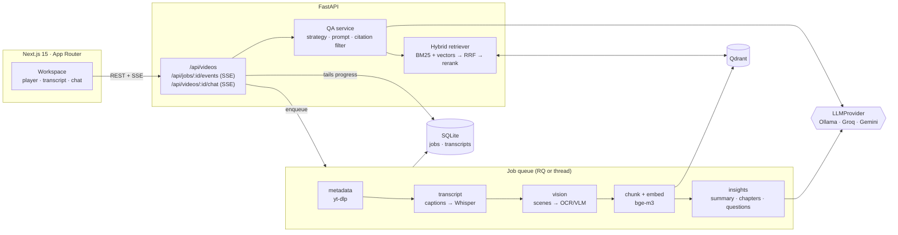
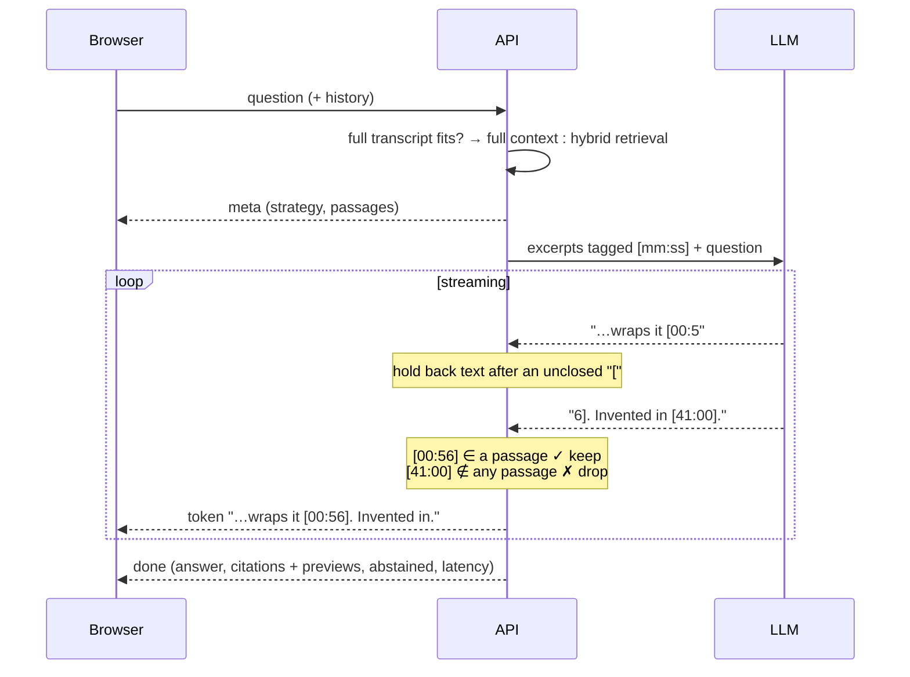

<div align="center">


# VidAsk

**Ask any YouTube video a question. Get the answer — and the exact second it comes from.**

Fully local · open-source models · Turkish & English · every timestamp verified

[](https://github.com/ruveydayldrm/vidask/actions/workflows/ci.yml)




</div>

---

Paste a link, ask *"what does `@log_function` actually do?"*, and VidAsk answers in a sentence with a **clickable `[00:56]`**. Click it and the embedded player jumps to that second — the screenshot below is that exact moment, with the slide being explained on screen and the transcript line highlighted. Ask something the video never covers and it says so instead of guessing.

<p align="center"></p>

## Why it's different

| | |
|---|---|
| 🎯 **Citations that can't lie** | The model may only cite passages that were actually put in its prompt. Every `[mm:ss]` is checked against those passages — **even mid-stream** — and fabricated ones are removed before the user ever sees them. |
| 🙅 **Knows when to say "not in the video"** | Unanswerable questions get an explicit, localized abstention (*"Videoda bu konudan bahsedilmiyor."*), measured in the eval. |
| 🧠 **Picks its own strategy** | Short transcript? The whole thing goes into the prompt. Long one? Hybrid **BM25 + dense vectors → RRF → cross-encoder rerank**. The decision is automatic and logged. |
| 🖼 **Reads the screen too** | Scene-change keyframes → OCR (+ optional VLM captions). Slides and code become searchable and citations are marked *"shown on screen"*. |
| 🇹🇷🇬🇧 **Bilingual by design** | Multilingual embeddings, Turkish-aware BM25 folding (`İ/ı`, suffix-tolerant), answers in the question's language, TR/EN UI. |
| 📏 **Measured, not vibes** | `make eval` runs a TR+EN test set with Recall@k, timestamp accuracy, abstention, LLM-judge correctness/faithfulness and an ablation table. |
| 🔌 **Local first, provider-agnostic** | One `LLMProvider` interface → Ollama (default), Groq, Gemini. Every model is a line in `.env`. GPU auto-detected; runs on a laptop CPU. |

## Screenshots

| Home (light) | Home (dark) |
|---|---|
|  |  |
| **Auto-generated chapters** | **Turkish UI, light theme** |
|  |  |

<details>
<summary>📱 Mobile</summary>
<p align="center"></p>
</details>

## Architecture



### How a citation is verified



## Quick start

### 🐳 Docker (one command)

```bash
cp .env.example .env
docker compose up --build          # → http://localhost:3000
# NVIDIA GPU:
TORCH_VARIANT=cu124 docker compose -f docker-compose.yml -f docker-compose.gpu.yml up --build
```

Starts the API, an RQ worker, the web app, Qdrant, Redis and Ollama (pulling `LLM_MODEL` on first run).

### 💻 Local (no Docker)

Requires Python 3.11+, [uv](https://docs.astral.sh/uv/), Node 20+, [Ollama](https://ollama.com).

```bash
ollama pull qwen2.5:3b
make install && make warmup        # deps + embedding/reranker models
make dev                           # API :8000 + web :3000
```

Without Docker, VidAsk uses **embedded Qdrant** and an **in-process job queue** automatically — no extra services. On Windows use `.\scripts\dev.ps1 install | dev | test | eval`.

## Choosing models for your hardware

Everything is set in `.env` ([`.env.example`](.env.example) documents every option). `DEVICE=auto` uses CUDA only when the GPU has ≥ `MIN_GPU_VRAM_GB`.

| Hardware | LLM | Embeddings / reranker | Whisper |
|---|---|---|---|
| Laptop CPU, 8–16 GB RAM | `qwen2.5:3b` | `paraphrase-multilingual-MiniLM-L12-v2` / `mmarco-mMiniLMv2-L12` | `small` |
| CPU, 32 GB RAM | `qwen2.5:7b` | `BAAI/bge-m3` / `bge-reranker-v2-m3` | `small` |
| GPU 8 GB | `qwen2.5:7b` | `BAAI/bge-m3` / `bge-reranker-v2-m3` | `medium` |
| GPU 16 GB+ | `qwen2.5:14b` | `BAAI/bge-m3` / `bge-reranker-v2-m3` | `large-v3` |
| No local LLM | Groq / Gemini free tier (`LLM_PROVIDER=groq`) | any | any |

## Evaluation

`make eval` → [`eval/results/latest.md`](eval/results/latest.md). The dataset ([`eval/datasets/vidask_v1.jsonl`](eval/datasets/vidask_v1.jsonl)) has **31 questions over 5 public videos** (3 EN, 2 TR; manual *and* noisy auto captions), including **5 unanswerable** and **cross-lingual** questions (Turkish question about an English video and vice versa). Gold spans were written by hand from the transcripts.

| Metric | What it measures |
|---|---|
| Recall@k / MRR | Is the gold time span among the retrieved passages? (retrieval ablation, no LLM) |
| Timestamp accuracy | Is the answer's first citation within ±15 s of the gold span? |
| Abstention accuracy | Does it refuse every unanswerable question? |
| False abstention | Does it wrongly refuse answerable ones? |
| Correctness / faithfulness | LLM-as-judge vs. the gold answer / vs. the cited passages |
| Latency | p50 / p95 end-to-end, including first token |

<!-- EVAL_RESULTS -->
Results are written to [`eval/results/`](eval/results/) with the exact models and hardware they were produced on.
<!-- /EVAL_RESULTS -->

## Design decisions

- **Captions before Whisper — but only in the spoken language.** YouTube's auto track reveals the spoken language; community-translated manual captions in other languages are skipped. (Found the hard way: an English video was being "transcribed" from its Turkish translation, so citations quoted words nobody said.)
- **Full context when it fits.** For a 6-minute video, RAG only adds ways to miss the answer. The switch is `FULL_CONTEXT_RATIO` of the model's window.
- **RRF instead of score blending.** BM25 and cosine scores live on different scales; reciprocal-rank fusion needs no tuning and is robust across languages.
- **Prefix-truncation stemming for BM25.** Crude, but effective for agglutinative Turkish (`videoda`, `videonun` → `video…`) and harmless for English.
- **Never trust model timestamps.** Validation runs on the token stream with a small hold-back buffer, so a fabricated `[41:00]` never flickers onto the screen.
- **Prompts written for 3B models.** A format example, the language instruction last, and no trailing "say NO_ANSWER" reminder — that one line made `qwen2.5:3b` refuse answerable questions. Leaked prompt markup is stripped.
- **SQLite as the progress bus.** The worker writes job state; the SSE endpoint tails it. Works identically for the RQ worker and the in-process fallback, with no pub/sub plumbing.
- **Vision is best-effort and bounded.** Only scene-change frames, capped and de-duplicated; failures skip the stage instead of failing the job.

## Project layout

```
backend/app/
  api/         FastAPI routes (REST + SSE)
  pipeline/    url → metadata → transcript → vision → chunking, job runner
  services/    retrieval, QA + citation validation, insights, store, queue
  providers/   LLMProvider (ollama · groq · gemini · fake), embeddings, reranker
  models/      Pydantic schemas
frontend/src/
  components/  home, workspace (player, transcript, chat, chapters), ui/ (shadcn-style)
  lib/         API client + SSE parser, i18n, time utils
eval/          dataset, harness, results
```

## Testing

```bash
make test     # 99 backend tests (pytest) + frontend component tests (vitest)
make lint     # ruff, mypy, eslint, tsc
```

Backend tests cover URL parsing (15 URL shapes), chunking invariants, citation validation including chunked-stream equivalence, abstention, provider wire formats (mocked HTTP), retrieval, insights parsing and the full API flow with fakes. CI runs everything on every push.

## Known limitations

- **YouTube blocks many cloud/datacenter IPs** for transcripts and downloads. VidAsk works best on a home/office connection; on a server you may need a residential proxy.
- **Small local models are small.** `qwen2.5:3b` follows the format and abstains well but sometimes picks a neighbouring passage or invents round chapter times (chapters are snapped to real boundaries to compensate). A 7B+ model or a hosted provider improves answers noticeably.
- **LLM-as-judge with a local 3B model is a weak judge**; treat judge scores as relative (between configs), not absolute.
- **CPU processing is slow-ish:** ~3 min for a 3-minute video including summary/chapters; Q&A ~5–20 s per answer.
- Videos without captions need Whisper, which on CPU runs at roughly real time with `small`.

## Roadmap

- [ ] Playlist / multi-video Q&A
- [ ] Speaker diarization ("what did the second guest say about…")
- [ ] Browser extension: ask from the YouTube page itself
- [ ] Larger, human-labelled eval set; per-language breakdown
- [ ] Export answers with citations as Markdown notes

## License

[MIT](LICENSE) © 2026 ruveydayldrm

<sub>🇹🇷 VidAsk, YouTube videolarına soru sormanızı ve cevabı tıklanabilir, doğrulanmış zaman damgalarıyla almanızı sağlayan, tamamen lokal çalışan açık kaynak bir asistandır.</sub>
